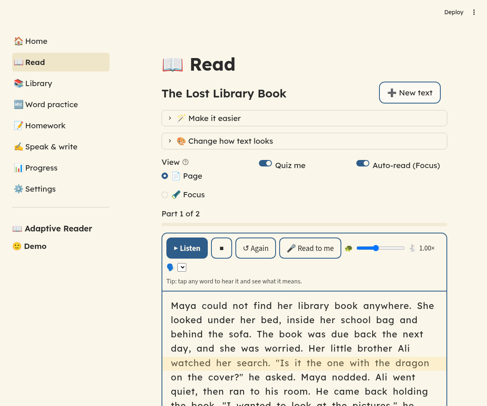
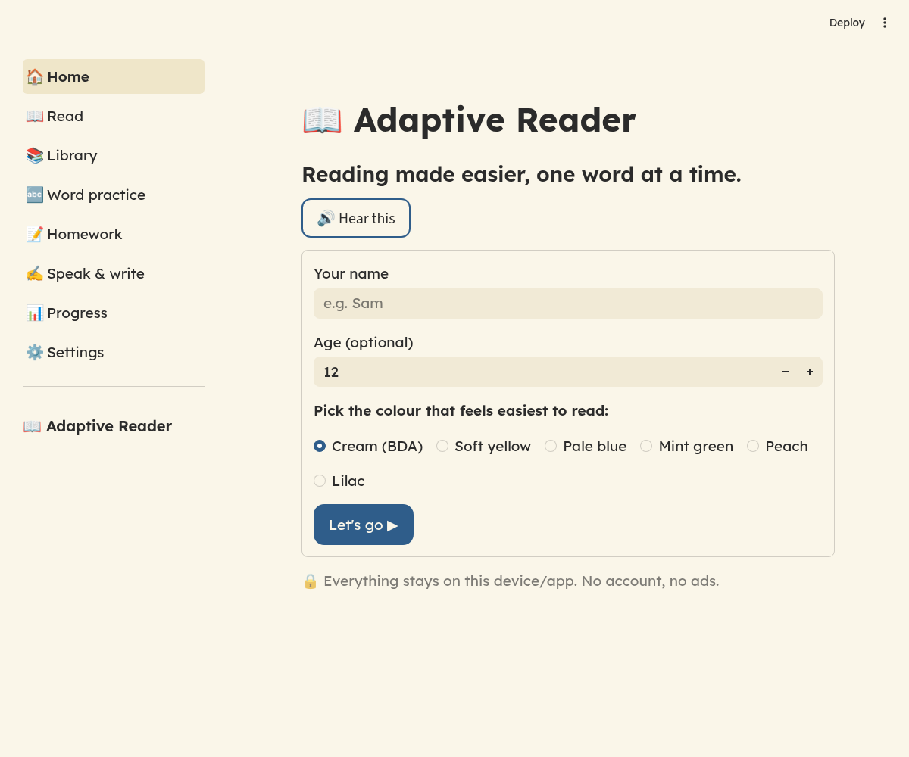
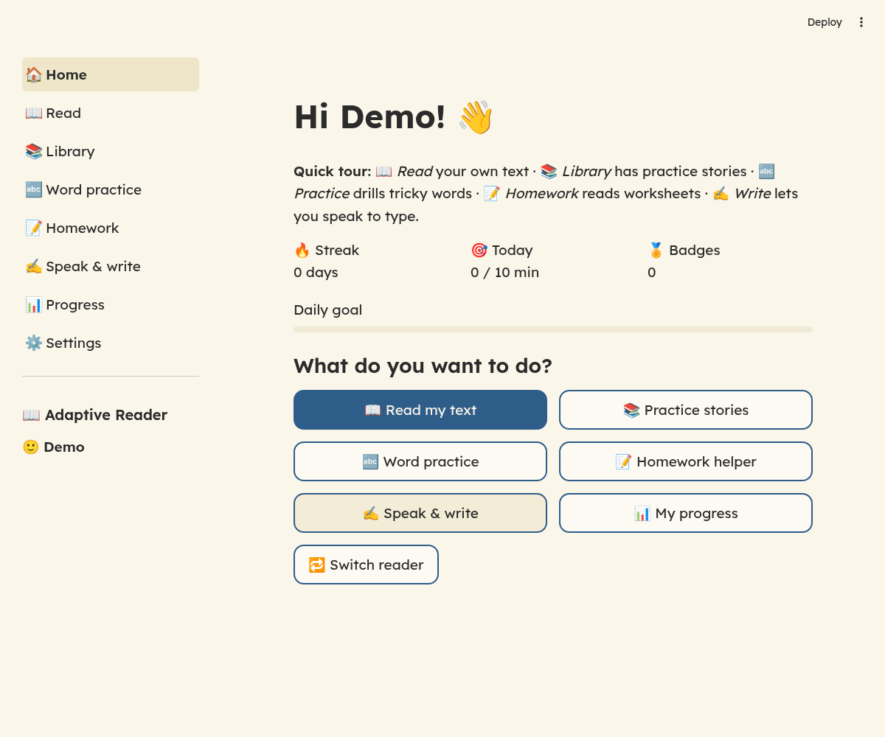
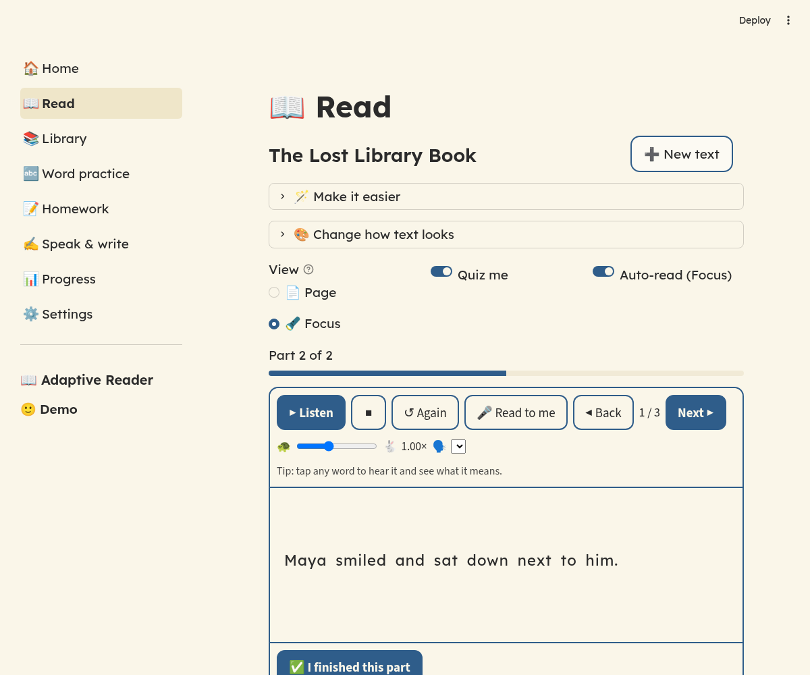
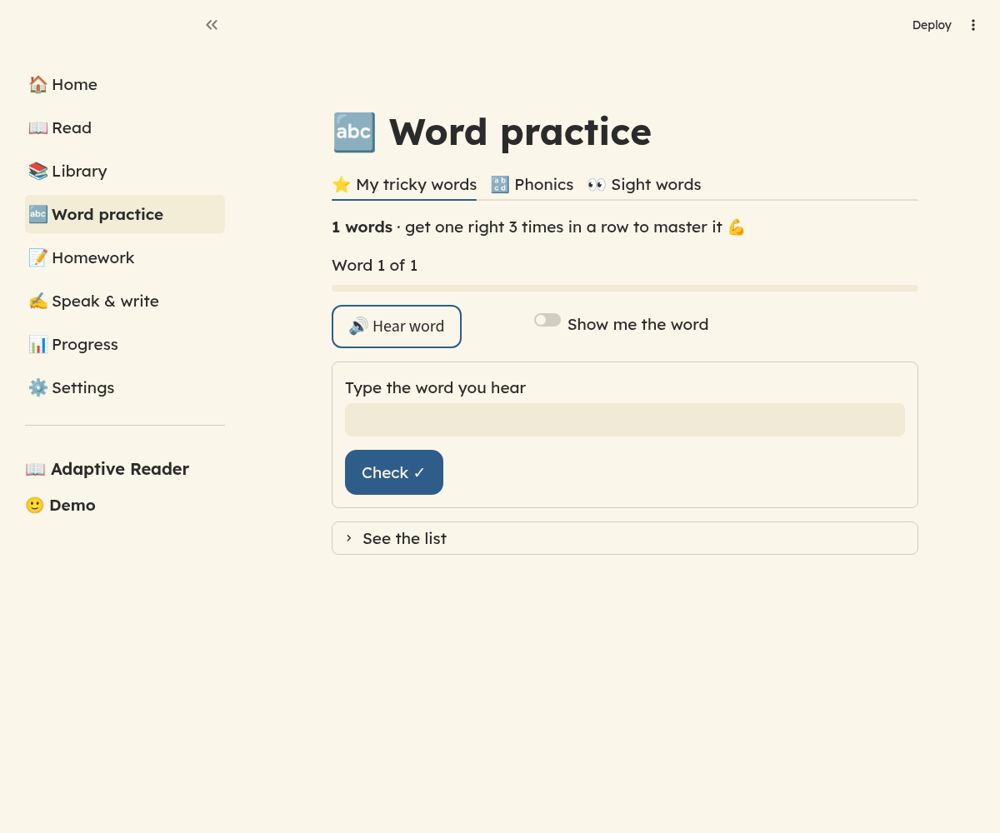
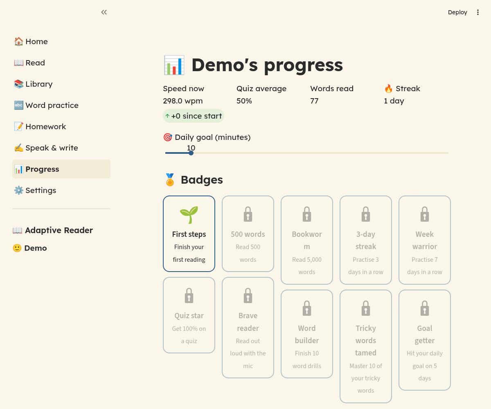

# 📖 Adaptive Reader

**Reading made easier, one word at a time.** A free web app that helps people aged 8–20 with dyslexia or
low vision read any text: it reads aloud with word-by-word highlighting, simplifies hard text, adapts its pace
to the learner, and tracks progress for parents and teachers.



## Problems it solves
- Dense text is tiring or impossible to decode for learners with dyslexia (around 1 in 10 people).
- Classroom materials come as photos, PDFs and worksheets that standard screen readers handle badly.
- Paid tools (Speechify, Read&Write) are expensive and don't adapt to a learner's progress.
- Teachers and parents rarely see objective data on reading speed and comprehension.

## Features
| Area | What it does |
|---|---|
| **Any text in** | Paste/type, PDF, Word (DOCX), TXT, or a photo/camera shot of a page (free on-device OCR with RapidOCR). |
| **Read aloud** | Browser voice with adjustable speed and voice choice, **word-by-word highlighting**, pause/resume, "Again" to repeat the sentence. MP3 fallback (gTTS). |
| **Dyslexia-friendly display** | Lexend / OpenDyslexic / Atkinson Hyperlegible fonts, size, letter/word/line spacing, 8 colour themes (BDA-based cream default, pastel overlays, low-glare dark, high contrast), reading ruler, bold word starts (bionic style). |
| **Focus mode** | One sentence at a time with big Back/Next buttons, auto-read each sentence. |
| **Tap a word** | Hears the word slowly and shows its meaning (dictionaryapi.dev, Wiktionary fallback). |
| **Make it easier** | Rewrite text to a reading level (age 7–9, 9–11, 11–14). Built-in free simplifier (plain-English word swaps, sentence splitting), or an AI rewrite with your own Groq/OpenAI/Gemini key. Readability before/after (Flesch reading ease, grade level). |
| **Adaptive coach** | Times each part (words per minute), counts repeats and word taps, uses quiz results, then suggests a voice speed and reading level, applied with one tap. |
| **Quick checks** | Questions after each part: auto fill-the-gap quizzes (free) or AI questions with a key. Questions can be read aloud. Spoken feedback and sounds. |
| **Read-along mic** | The learner reads out loud; the app follows along, ticks words in green and gently marks skipped/misread words in orange (Chrome/Edge). |
| **Tricky-word tracker** | Words tapped, repeated, misread, or corrected are saved to a personal list, practised by "hear it, spell it" until mastered (3 in a row). |
| **Practice library** | 12 original graded passages (Beginner → Advanced; stories, everyday texts, science, history), 14 phonics patterns, 6 sight-word sets with flashcards. |
| **Homework helper** | Photo of a worksheet → questions split out → each read aloud → answer by voice or typing, spelling hints, save answers. |
| **Speak & write** | Voice typing, one-tap spelling fixes, tidy capitals/full stops, read back aloud, save. |
| **Motivation** | Daily goal, streaks, 10 badges. |
| **Progress & sharing** | Charts of speed, quiz scores and minutes per day; downloadable HTML report for teachers/parents, CSV export. |
| **Accessible UI** | Big buttons (≥52 px), simple navigation, keyboard support (Tab to words, Enter = meaning, Space = read from here, Esc = close), minimal text, audio cues, friendly onboarding with a spoken welcome. |

## Why these colours (research)
The default theme follows the **British Dyslexia Association Dyslexia Style Guide**: use a cream or soft pastel
background instead of white, dark grey text instead of pure black, sans-serif fonts, larger text, 1.5+ line spacing,
left-aligned text and no italics/underlines. Coloured overlays (soft yellow, blue, green, peach, lilac) are offered
because individual preferences vary.

- British Dyslexia Association, *Dyslexia Style Guide 2023*: https://www.bdadyslexia.org.uk/advice/employers/creating-a-dyslexia-friendly-workplace/dyslexia-friendly-style-guide
- Rello, L. & Baeza-Yates, R. (2013), *Good fonts for dyslexia*, ASSETS '13: sans-serif, roman fonts read faster; italics slow readers.
- Rello, L. & Bigham, J. (2017), *Good Background Colors for Readers*, ASSETS '17: warm/pastel backgrounds (e.g. peach, cream) improved reading for people with dyslexia.
- Lexend font research (Shaver-Troup): wider letter spacing improves reading fluency for many readers. https://www.lexend.com
- W3C WCAG 2.2: contrast, target size and keyboard access guidance. https://www.w3.org/TR/WCAG22/

## Run it locally
```bash
pip install -r requirements.txt
streamlit run app.py
```
Use Chrome or Edge for the microphone features (read-along, voice typing). Read-aloud works in all modern browsers.

**Optional AI:** add one key to `.streamlit/secrets.toml` (`GROQ_API_KEY`, `OPENAI_API_KEY` or `GEMINI_API_KEY`) or paste it in ⚙️ Settings.
Everything else works without any key.

## Deploy (Streamlit Community Cloud)
Repository → branch `main` → main file `app.py`. `packages.txt` installs the system libraries needed for OCR.

## Project structure
```
app.py              navigation only
config/brand.toml   app name, icon, default theme, feature switches (white-label for schools)
core/               pure logic, no UI: text input/OCR, readability & simplifier, quizzes, adaptive coach,
                    read-along alignment, spelling, homework parsing, progress/badges, reports, storage
ui/                 Streamlit screens, styling and browser components (speech, mic, reader)
tests/              unit tests for core logic + app smoke tests (pytest)
```
Core logic has no Streamlit dependency, so it can be reused behind a mobile app or API later.

## Privacy
No accounts or ads. Profiles and progress are stored in a local JSON file (`data/`). Speech uses the browser's
built-in speech features. Only the tapped word goes to the dictionary service; text is sent to an AI provider only
if you turn on the AI helper with your own key. Photos are processed and not stored. On a shared online demo,
other visitors can see profile names, so use a nickname.

## Screenshots
| Welcome | Home | Focus mode |
|---|---|---|
|  |  |  |
| **Word practice** | **Progress & badges** | |
|  |  | |

## Tests
```bash
pytest -q
```

---
© 2026 Kinza Amjad. All rights reserved. See [LICENSE](LICENSE).
